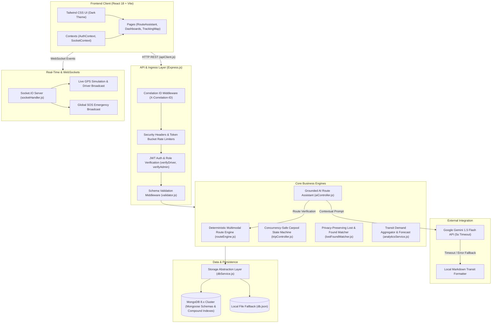
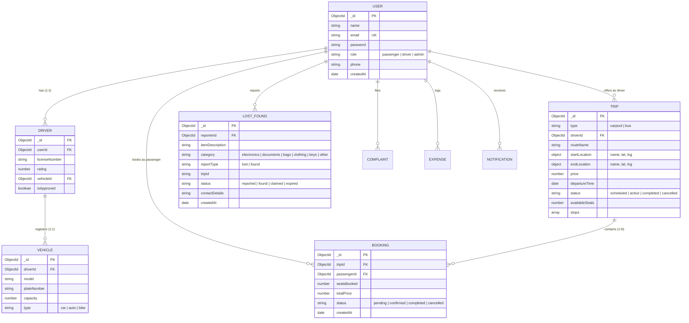
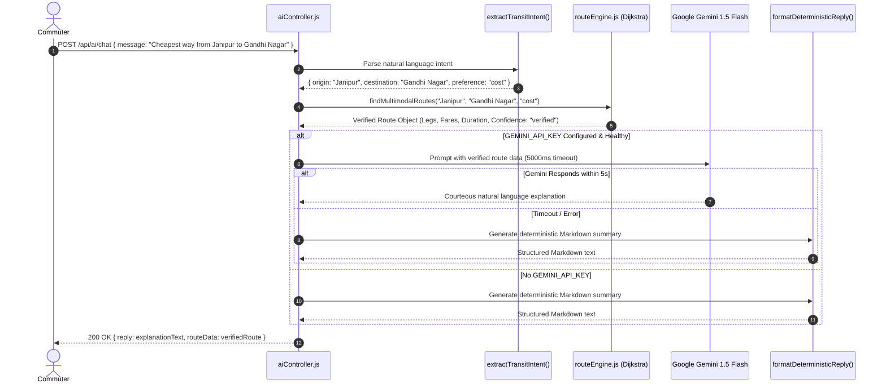

# 🚍 JammuMove — Intelligent Multimodal Urban Transit & Real-Time Carpooling Platform

[](https://github.com/jammumove/jammumove/actions/workflows/ci.yml)


**JammuMove** is a production-quality urban mobility and community ridesharing platform tailored for the unique transport topography of **Jammu, Jammu & Kashmir**. It bridges the gap between public bus transit (*matadors* and JKRTC Smart Electric Buses), localized e-rickshaws, shared autos, and private peer-to-peer carpools across congested Jammu arterial corridors (Janipur, Jewel Chowk, Panjtirthi, Gandhi Nagar, Jammu Tawi Railway Station, Bari Brahmana, and Jammu University).

---

## 📑 Table of Contents

- [Problem Statement & Target Users](#-problem-statement--target-users)
- [System Architecture (Mermaid)](#-system-architecture)
- [Technology Stack & Architectural Justifications](#-technology-stack--architectural-justifications)
- [Feature List (Actually Implemented)](#-feature-list-actually-implemented)
- [Database Collections, Fields & Relationships](#-database-collections-fields--relationships)
- [Route Optimization Algorithm & Fare Logic](#-route-optimization-algorithm--fare-logic)
- [AI Architecture & Grounded Route Generation](#-ai-architecture--grounded-route-generation)
- [RBAC Model & Security Controls](#-rbac-model--security-controls)
- [API Reference with Concrete Request & Response Examples](#-api-reference)
- [Environment Configuration](#-environment-configuration)
- [Local Setup & Execution Guide](#-local-setup--execution-guide)
- [Automated Testing Strategy & CI Pipeline](#-automated-testing-strategy--ci-pipeline)
- [Deployment Readiness & Production Considerations](#-deployment-readiness--production-considerations)
- [Honest Limitations & Roadmap](#-honest-limitations--roadmap)

---

## 🎯 Problem Statement & Target Users

### The Problem in Jammu, J&K
Jammu city features a fragmented urban transit landscape:
1. **Corridor Bottlenecks**: Arterial bottlenecks such as Jewel Chowk, Janipur High Court Road, Panjtirthi Circular Road, and the Tawi Bridges experience heavy congestion during peak court and government office hours.
2. **Disconnected Modal Systems**: Commuters must switch between municipal electric buses (Route 1A and Route 4), informal *matador* mini-buses, shared autos, and last-mile e-rickshaws without unified timetable, fare, or transfer visibility.
3. **Low Vehicle Occupancy**: Thousands of private commuters drive identical routes (e.g., Janipur to Gandhi Nagar or Bari Brahmana industrial zone) with empty passenger seats due to lack of a trusted local carpooling platform.
4. **Commuter Anxiety**: Lost personal items on buses have no centralized recovery system, forcing commuters to visit physical depots. Women and solo commuters lack live route tracking and emergency SOS dispatch.

### Target Users
- **Daily Commuters & Students**: Commuters traveling daily to Jammu University, Government Medical College (GMC), Civil Secretariat, and district courts needing affordable multimodal journey options.
- **Office Commuters & Drivers**: Vehicle owners seeking to offset rising fuel expenses by offering verified carpool seats along major Jammu corridors.
- **Transit Administrators**: City planners and transport operators monitoring corridor congestion indices, demand patterns, and grievance queues.

---

## 🏛 System Architecture

The following Mermaid diagram illustrates the end-to-end request lifecycle and component boundaries:



---

## 💻 Technology Stack & Architectural Justifications

| Layer | Technology | Architectural Justification |
|---|---|---|
| **Frontend Framework** | React 18 (Vite) | Fast HMR, component reusability, modular state encapsulation with Context API without Redux boilerplate. |
| **Styling & Icons** | Tailwind CSS + Lucide React | Utility-first styling enabling the JammuMove responsive dark navy UI theme (`bg-slate-900`, `text-blue-400`); zero runtime CSS overhead. |
| **Backend Runtime** | Node.js (v18+/v20+) | High-throughput asynchronous non-blocking event loop ideal for concurrent REST requests and WebSocket broadcasts. |
| **API Framework** | Express.js 4.19 | Mature, unopinionated routing middleware ecosystem allowing custom correlation tracking, token buckets, and centralized error sanitization. |
| **Real-Time Layer** | Socket.IO 4.7 | Bidirectional WebSocket communication with automatic fallback to HTTP long-polling for live GPS driver simulation and emergency SOS alerts. |
| **Database & ODM** | MongoDB + Mongoose 8.x | Document model naturally accommodates polymorphic transit structures (`bus` vs `carpool`), embedded geo-coordinates (`lat`, `lng`), and atomic conditional operators (`$inc`, `$gte`). |
| **Data Abstraction** | Custom `dbService.js` | Decouples business logic from Mongoose, seamlessly providing zero-configuration offline local JSON persistence when MongoDB is not running. |
| **AI Integration** | Google Gemini 1.5 Flash | Fast (~500ms), cost-effective LLM strictly grounded by feeding verified Dijkstra algorithm results into prompt context to prevent transit hallucinations. |
| **Automated Testing** | Node.js Native Runner (`node:test`) | Zero external test dependencies (no Jest/Mocha bloat), native ESM/CJS support, subsecond execution of 84 unit and integration tests. |
| **Static Verification** | Oxlint | Fast Rust-based linter enforcing clean React patterns and zero unused imports across the frontend. |

---

## 🚀 Feature List (Actually Implemented)

### 1. Multimodal Route Engine & Journey Planner
- **Multi-Hub Graph**: Connects 10 canonical transit nodes in Jammu (`janipur`, `jewelChowk`, `gandhiNagar`, `jammuUniversity`, `railwayStation`, `channiHimmat`, `satwari`, `talabTillo`, `panjtirthi`, `parade`).
- **Multimodal Routing**: Calculates combined transit legs using Smart Electric Buses (Route 1A and Route 4), shared e-rickshaws, walking transfers ($\le 1.2\text{ km}$), and dynamic carpools.
- **Optimization Modes**: Supports user-selected optimization by `duration` (fastest), `cost` (cheapest), or `transfers` (minimal modal changes).
- **Alternative Routes**: Penalty-based path search returning up to 2 distinct route itineraries.

### 2. Grounded AI Route Assistant
- **Intent Extraction**: Tokenizes natural language queries to identify origin, destination, and preference keywords (`cheapest`, `quickest`).
- **Two-Layer Reliability**: The LLM never invents stops or fares; it explains verified Dijkstra engine output. If Gemini fails or times out (5000ms), the system falls back to a deterministic Markdown formatter.
- **Fare Predictor & Spam Checker**: Distance-tiered fare calculator and carpool listing validator rejecting zero fares, $>₹500$ local city prices, or identical pickup/dropoff points.

### 3. Concurrency-Safe Carpool State Machine
- **Atomic Seat Booking**: Enforces seat reservation safety under concurrent requests using atomic conditional increments (`$inc: { availableSeats: -seats }` where `availableSeats >= seats`).
- **Strict State Machine**: Enforces state transitions (`pending` $\rightarrow$ `confirmed` / `cancelled` / `completed`).
- **Driver Passenger Manifest**: Drivers can review commuter manifests, accept or reject pending requests, and view passenger contacts.
- **Cancellation & Seat Recovery**: Passenger or driver cancellations automatically restore seat capacity back to the ride atomically.

### 4. Transit Demand Analytics
- **Historical Metrics**: Aggregates completed rides and bookings using MongoDB aggregation pipelines to identify top departure/arrival hubs, passenger volume, and seat capacity utilization.
- **Time-of-Day Traffic Heuristic**: Evaluates congestion indices for Jammu arterial corridors across Morning Peak (08:30–11:00 AM, 1.35x), Evening Peak (05:30–08:00 PM, 1.40x), and Night Off-Peak (0.85x).
- **Transparent Empty States**: Shows an explicit insufficient-data message when fewer than 2 data points exist, never fabricating mock statistics.

### 5. Privacy-Preserving Lost & Found Matching
- **Multi-Attribute Scoring**: Evaluates candidate matches based on Category Equivalence (Electronics, Documents, Bags, Clothing, Keys), Corridor/Trip Match, Jaccard Keyword Overlap, and Temporal Proximity.
- **Privacy Masking**: Automatically masks phone numbers (`+91-94191-XXXXX`) and emails (`u***@domain.com`) in candidate lists.
- **Duplicate Prevention**: Rejects duplicate reports from the same commuter within 24 hours.

### 6. Emergency SOS & Real-Time Tracking
- **Global SOS Dispatch**: Rate-limited SOS trigger broadcasting emergency alert notifications with GPS coordinates to active listeners.
- **Live GPS Tracking**: Room-based Socket.IO driver tracking simulation showing vehicle location updates along route paths.

---

## 🗄 Database Collections, Fields & Relationships



### Compound Indexes for High-Throughput Queries
- `TripSchema.index({ type: 1, status: 1 });` — Fast carpool vs bus filtering.
- `TripSchema.index({ driverId: 1, status: 1 });` — Driver ride history and active offering lookup.
- `BookingSchema.index({ tripId: 1, passengerId: 1, status: 1 });` — Concurrency-safe duplicate booking check.
- `BookingSchema.index({ passengerId: 1, createdAt: -1 });` — Commuter booking ledger sorting.
- `LostFoundSchema.index({ reportType: 1, status: 1, category: 1 });` — Fast candidate matching queries.
- `NotificationSchema.index({ userId: 1, read: 1, createdAt: -1 });` — Unread alert querying.

---

## 🧮 Route Optimization Algorithm & Fare Logic

### Graph Representation
The Jammu transit network is represented as a directed multigraph $G = (V, E)$, where:
- $V$: The 10 canonical hubs with GPS coordinates ($\text{lat}, \text{lng}$).
- $E$: Directed edges representing verified transit connections:
  - **Electric Bus (Route 1A & Route 4)**: Fixed municipal fares (₹10 to ₹25) and scheduled runtimes.
  - **Shared E-Rickshaw / Autos**: Intermediate connecting corridors (e.g., Jewel Chowk to Railway Station).
  - **Walking Legs**: Short pedestrian hops ($\le 1.2\text{ km}$) connecting adjacent hubs (e.g., Panjtirthi to Parade Ground) with ₹0 fare.
  - **Active Carpools**: Dynamically ingested from scheduled carpools in the database.

### Multi-Criteria Dijkstra Weight Function
The edge weight $W(e)$ is evaluated dynamically based on user preference:

$$\text{Transfer Penalty} = \begin{cases} 5\text{ mins}, & \text{if } \text{mode}_{prev} \neq \text{mode}_{curr} \\ 0\text{ mins}, & \text{otherwise} \end{cases}$$

- **`duration` (Fastest)**:
  $$W(e) = \text{durationMins} + \text{Transfer Penalty} + 0.05 \times \text{fare}$$
- **`cost` (Cheapest)**:
  $$W(e) = \text{fare} + 0.10 \times \text{durationMins}$$
  *(Walking legs have ₹0 fare, heavily prioritized).*
- **`transfers` (Fewer Transfers)**:
  $$W(e) = 50 + (\text{if walking then } 10 \text{ else } 0) + 0.50 \times \text{durationMins}$$

### Alternative Routes Generation
When multiple paths exist, an alternative route is generated by applying a $2.5\times$ penalty multiplier to edges used in the primary path and rerunning Dijkstra, ensuring the commuter is offered a genuinely distinct itinerary.

---

## 🤖 AI Architecture & Grounded Route Generation



### Hallucination Prevention
1. The AI model is **never** asked to search for routes or invent transit stops.
2. The deterministic Dijkstra engine resolves canonical hubs and calculates fares first.
3. The LLM receives the verified legs as immutable facts in its system prompt with strict instructions: *"DO NOT invent, hallucinate, or alter any stops, transfers, transport modes, fares, or durations."*

---

## 🔐 RBAC Model & Security Controls

### Role Matrix

| Endpoint / Action | Public / Guest | Passenger | Driver (Approved) | Admin |
|---|:---:|:---:|:---:|:---:|
| Search Trips & View Bus Schedules | ✅ | ✅ | ✅ | ✅ |
| Calculate Multimodal Routes | ✅ | ✅ | ✅ | ✅ |
| Conversational Route Assistant | ✅ | ✅ | ✅ | ✅ |
| Book Carpool Seat | ❌ | ✅ | ❌ (Cannot self-book) | ❌ |
| Publish Carpool Ride | ❌ | ❌ | ✅ | ✅ |
| Accept / Reject Passenger Booking | ❌ | ❌ | ✅ (Own trip only) | ✅ |
| Cancel Booking | ❌ | ✅ (Own booking) | ✅ (Own trip) | ✅ |
| View Passenger Manifest | ❌ | ❌ | ✅ (Own trip only) | ✅ |
| File Lost & Found Report | ❌ | ✅ | ✅ | ✅ |
| View Candidate Match Contacts | ❌ | ✅ (Masked PII) | ✅ (Masked PII) | ✅ (Full Audit) |
| Detailed Demand Analytics | ❌ | ❌ | ✅ | ✅ |
| Driver Approval & User Management | ❌ | ❌ | ❌ | ✅ |

### Security Infrastructure
- **Security Headers (`security.js`)**: Injects `X-Content-Type-Options: nosniff`, `X-Frame-Options: DENY`, `X-XSS-Protection: 1; mode=block`, and `Referrer-Policy: same-origin`.
- **Token Bucket Rate Limiters (`security.js`)**:
  - Auth routes (`/api/auth/*`): 30 requests per 15 minutes.
  - Emergency SOS (`/api/utility/sos`): 10 requests per 5 minutes.
  - General API: 500 requests per 15 minutes.
- **Centralized Error Sanitization (`errorHandler.js`)**: Captures all unhandled errors, suppresses internal database stack traces in production (`NODE_ENV === 'production'`), and returns structured JSON error responses.
- **Request Correlation Tracking (`correlationId.js`)**: Automatically tags every request with an `X-Correlation-ID` UUID header, tracked across sanitized logs.

---

## 📡 API Reference

### 1. Multimodal Route Calculation
`POST /api/routes/multimodal` (Public)

**Request Body**:
```json
{
  "origin": "Janipur",
  "destination": "Gandhi Nagar",
  "preference": "cost"
}
```

**Response (200 OK)**:
```json
{
  "success": true,
  "origin": { "id": "janipur", "name": "Janipur" },
  "destination": { "id": "gandhiNagar", "name": "Gandhi Nagar" },
  "preference": "cost",
  "routes": [
    {
      "routeId": "route_1",
      "label": "Primary Recommendation",
      "summary": "Route 1A E-Bus",
      "confidence": "verified",
      "totalDistanceKm": 6.4,
      "totalDurationMins": 27,
      "totalFare": 20,
      "transfers": 0,
      "modes": ["bus"],
      "legs": [
        {
          "legIndex": 1,
          "mode": "bus",
          "line": "Route 1A E-Bus",
          "from": "Janipur",
          "to": "Gandhi Nagar",
          "distanceKm": 6.4,
          "durationMins": 27,
          "fare": 20,
          "confidence": "verified",
          "instruction": "Board direct Route 1A E-Bus from Janipur Main Chowk via Jewel Chowk to Gandhi Nagar."
        }
      ]
    }
  ]
}
```

### 2. Conversational Route Assistant
`POST /api/ai/chat` (Public)

**Request Body**:
```json
{
  "message": "What is the fastest route from Janipur to Jammu Tawi Railway Station?"
}
```

**Response (200 OK)**:
```json
{
  "reply": "### 🚍 Recommended Journey: Janipur ➔ Jammu Tawi Railway Station\n- **Preference**: Fastest Route (Duration)\n- **Total Fare**: ₹35\n- **Estimated Duration**: ~32 minutes\n- **Transfers**: 1 transfer\n\n#### Step-by-Step Directions:\n1. **[BUS]** Board Route 1A Smart Electric Bus towards Jewel Chowk at Janipur Main Chowk. (15 mins, ₹15)\n2. **[ERICKSHAW]** Take shared E-Rickshaw from Jewel Chowk to Jammu Tawi Railway Station. (17 mins, ₹20)",
  "routeData": { "success": true, "origin": { "id": "janipur" }, "destination": { "id": "railwayStation" } }
}
```

### 3. Concurrency-Safe Carpool Booking
`POST /api/trips/book` (Authenticated Passenger)

**Headers**: `Authorization: Bearer <JWT_TOKEN>`

**Request Body**:
```json
{
  "tripId": "660c29f8a12b3c4d5e6f7a8b",
  "seats": 2
}
```

**Response (201 Created)**:
```json
{
  "message": "Booking request sent to driver. Awaiting confirmation.",
  "booking": {
    "_id": "660c29f8a12b3c4d5e6f7a8c",
    "tripId": "660c29f8a12b3c4d5e6f7a8b",
    "passengerId": "660c29f8a12b3c4d5e6f7a80",
    "seatsBooked": 2,
    "totalPrice": 120,
    "status": "pending",
    "createdAt": "2026-10-21T16:30:00.000Z"
  }
}
```

### 4. Respond to Booking Request
`PATCH /api/trips/bookings/:bookingId/respond` (Driver / Admin)

**Request Body**:
```json
{
  "action": "accept"
}
```

**Response (200 OK)**:
```json
{
  "message": "Booking confirmed successfully.",
  "booking": {
    "_id": "660c29f8a12b3c4d5e6f7a8c",
    "status": "confirmed"
  }
}
```

### 5. Candidate Lost & Found Matches
`GET /api/utility/lost-found/:itemId/matches` (Owner / Admin)

**Response (200 OK)**:
```json
{
  "targetItem": {
    "_id": "mock_fx80f6to3",
    "itemDescription": "Black Lenovo 65W Laptop USB-C Charger",
    "reportType": "lost"
  },
  "matchesCount": 1,
  "matches": [
    {
      "candidateId": "mock_pmzed4mbl",
      "confidenceLevel": "High",
      "matchScore": 88,
      "maskedContact": "Commuter Two - +91-94191-XXXXX",
      "matchSignals": [
        { "signal": "Category Match", "detail": "electronics" },
        { "signal": "Transit Location Overlap", "detail": "Route 1A Bus" },
        { "signal": "Descriptive Keyword Overlap", "detail": "Matched tokens: lenovo, charger, 65w" }
      ]
    }
  ]
}
```

### 6. Health & Readiness Probes
`GET /health` | `GET /ready` (Public)

**Response (200 OK)**:
```json
{
  "status": "ready",
  "timestamp": "2026-10-21T16:40:00.000Z",
  "database": "connected",
  "storageMode": "mongodb"
}
```

---

## ⚙ Environment Configuration

Create a `.env` file in `backend/` following `backend/.env.example`:

```env
# Server Configuration
PORT=5000
NODE_ENV=development

# Authentication
JWT_SECRET=your_super_secret_jwt_key_at_least_32_chars_long

# Database Connection (Optional - defaults to resilient local db.json if unset)
MONGO_URI=mongodb://localhost:27017/jammumove

# Google Gemini API Key (Optional - falls back to deterministic Markdown router if unset)
GEMINI_API_KEY=your_gemini_api_key_here

# Client CORS Ingress
CLIENT_URL=http://localhost:5173
```

Create a `.env` file in `frontend/` following `frontend/.env.example`:

```env
VITE_API_URL=http://localhost:5000
VITE_SOCKET_URL=http://localhost:5000
```

---

## 💻 Local Setup & Execution Guide

### Prerequisites
- **Node.js**: v18.0.0 or higher (v20+ recommended).
- **npm**: v9.0.0 or higher.
- **MongoDB** *(Optional)*: If MongoDB is not installed, JammuMove operates seamlessly using its built-in local JSON storage abstraction (`dbService.js`).

### 1. Installation
```bash
# Clone the repository
git clone https://github.com/your-username/jammumove.git
cd jammumove

# Install backend dependencies
cd backend
npm install

# Install frontend dependencies
cd ../frontend
npm install
```

### 2. Running Backend & Frontend
In terminal 1 (Backend):
```bash
cd backend
npm run dev
# Starts Express & Socket.IO on http://localhost:5000
```

In terminal 2 (Frontend):
```bash
cd frontend
npm run dev
# Starts Vite React development server on http://localhost:5173
```

Open your browser at `http://localhost:5173`.

---

## 🧪 Automated Testing Strategy & CI Pipeline

JammuMove adopts a test-driven development strategy utilizing Node's built-in test runner (`node:test`) for zero-overhead, deterministic testing.

```bash
cd backend
npm test
```

### Test Coverage Across 12 Suites (84 Tests Total)
```
✔ Unit Tests: Deterministic Route Engine (8 tests)
  - Canonical hub mapping, Haversine formula, Dijkstra duration/cost/transfers weights, edge cases
✔ Unit Tests: Lost & Found Similarity Engine (3 tests)
  - Tokenization, Jaccard similarity, contact phone/email redaction
✔ Unit Tests: Transit Demand Analytics Engine (2 tests)
  - Time-of-day traffic model, structured demand metrics
✔ Unit Tests: Structured Logger & Data Sanitization (1 test)
  - Scrubbing passwords, tokens, Bearer authorization headers
✔ AI Features & Validation Middleware Tests (8 tests)
  - Intent extraction, fallback responses, fare predictor bounds, spam detector
✔ Multimodal Route Engine & AI Assistant Integration Tests (12 tests)
  - End-to-end multimodal route calculation, walking transfers, keyword detection
✔ Phase 3: Transit Demand Analytics & Lost & Found Matching (11 tests)
  - RBAC on analytics, duplicate report blocking, privacy redaction verification
✔ Phase 4: Robust Carpool Lifecycle & Concurrency (10 tests)
  - Concurrent atomic seat reservation, state transitions, driver manifests
✔ Phase 5: Production Readiness, Health Probes & Resilience (11 tests)
  - Liveness/readiness probes, correlation ID roundtrip, AI timeout fallback, pagination
✔ RBAC and Role-Based Authorization Tests (7 tests)
✔ Security, Authentication & Input Validation Tests (6 tests)
✔ Trips, Single Fetch, and Booking Tests (7 tests)

Result: 84 passed, 0 failed (100% pass rate in ~21s)
```

### Continuous Integration (GitHub Actions)
Located in `.github/workflows/ci.yml`, the workflow runs on every pull request to `main`:
1. Installs backend dependencies on Node 20.
2. Executes `npm test` verifying all 84 unit and integration tests pass.
3. Installs frontend dependencies.
4. Executes `npx oxlint` verifying static code cleanliness with 0 errors.
5. Executes `npm run build` verifying production Vite compilation.

---

## 🛡 Deployment Readiness & Production Considerations

1. **Graceful Draining (`server.js`)**:
   - Handles `SIGTERM` and `SIGINT` signals by unbinding HTTP sockets, clearing active GPS simulation timers, and closing MongoDB connection pools with a bounded 10-second timeout.
2. **Container Liveness & Readiness**:
   - `/health`: Liveness probe for Kubernetes / Docker container health checks.
   - `/ready`: Readiness probe verifying database connectivity before routing ingress traffic.
3. **Defensive Error Handling**:
   - `unhandledRejection` and `uncaughtException` listeners log correlation IDs and errors without memory leaks or exposing credentials.

---

## 📋 Honest Limitations & Roadmap

| Feature | Current Implementation | Production Roadmap Improvement |
|---|---|---|
| **Transit Graph** | 10 canonical hubs in Jammu city | Integration with OpenStreetMap (OSM) / Overpass API for polygon-based routing across all Jammu districts. |
| **Payment Processing** | Cash & peer-to-peer fare accounting | Razorpay / UPI intent gateway integration with escrow release upon trip completion. |
| **Real-Time GPS** | Simulated GPS updates over Socket.IO rooms | Native driver mobile background GPS geolocation tracking via React Native / Flutter. |
| **Caching Layer** | In-memory graph and database queries | Redis cluster for caching high-frequency route lookups (`Janipur -> Railway Station`). |
| **WebSockets Scaling** | Single-node Socket.IO server | Redis adapter (`@socket.io/redis-adapter`) for horizontal multi-instance scaling. |
