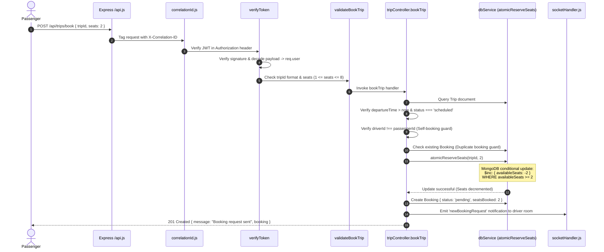

# 🎓 JammuMove — Technical Interview Preparation Guide
### Comprehensive Engineering Reference for Fresher Off-Campus Software Engineering Roles

---

## 📑 Table of Contents

1. [Project Overview & Elevator Pitches](#1-project-overview--elevator-pitches)
   - [60-Second Elevator Pitch](#60-second-elevator-pitch)
   - [Detailed 3-Minute Technical Deep Dive](#detailed-3-minute-technical-deep-dive)
   - [Individual Technical Contributions Matrix](#individual-technical-contributions-matrix)
2. [Frontend Architecture & Deep Dive](#2-frontend-architecture--deep-dive)
   - [Component Hierarchy & Responsiveness](#component-hierarchy--responsiveness)
   - [State Management & React Contexts](#state-management--react-contexts)
   - [React Hooks & API Integration](#react-hooks--api-integration)
   - [Loading, Error & Empty States](#loading-error--empty-states)
3. [Backend Architecture & Request Flow](#3-backend-architecture--request-flow)
   - [Node.js Runtime & Express Middleware Chain](#nodejs-runtime--express-middleware-chain)
   - [End-to-End Request Lifecycle](#end-to-end-request-lifecycle)
   - [Authentication, RBAC & Security Infrastructure](#authentication-rbac--security-infrastructure)
   - [Centralized Error Handling & Input Validation](#centralized-error-handling--input-validation)
4. [Database & Schema Engineering](#4-database--schema-engineering)
   - [MongoDB Schema Design & Relationships](#mongodb-schema-design--relationships)
   - [Indexing Strategy & Query Optimization](#indexing-strategy--query-optimization)
   - [Concurrency-Safe Atomic Operations](#concurrency-safe-atomic-operations)
   - [Storage Abstraction Layer (Mongoose vs Local Fallback)](#storage-abstraction-layer-mongoose-vs-local-fallback)
5. [Algorithms & Computational Logic](#5-algorithms--computational-logic)
   - [Multimodal Transit Graph Topology](#multimodal-transit-graph-topology)
   - [Multi-Criteria Dijkstra Shortest-Path Algorithm](#multi-criteria-dijkstra-shortest-path-algorithm)
   - [Complexity Analysis & Edge Penalties](#complexity-analysis--edge-penalties)
   - [Jaccard Similarity Matching Engine](#jaccard-similarity-matching-engine)
   - [Deterministic Engine vs AI Boundary](#deterministic-engine-vs-ai-boundary)
6. [AI Integration & Grounded Route Reliability](#6-ai-integration--grounded-route-reliability)
   - [Two-Layer Grounded Architecture](#two-layer-grounded-architecture)
   - [Prompt Design & Anti-Hallucination Guardrails](#prompt-design--anti-hallucination-guardrails)
   - [Timeout Handling, Fallbacks & Error Recovery](#timeout-handling-fallbacks--error-recovery)
7. [Production Engineering, Observability & CI/CD](#7-production-engineering-observability--cicd)
   - [Structured Logging & Correlation IDs](#structured-logging--correlation-ids)
   - [Health & Readiness Probes](#health--readiness-probes)
   - [Graceful Shutdown & Resilience](#graceful-shutdown--resilience)
   - [Test Strategy (84 Automated Tests) & GitHub Actions CI](#test-strategy-84-automated-tests--github-actions-ci)
8. [Comprehensive Interview Question Bank (35+ Questions)](#8-comprehensive-interview-question-bank-35-questions)
   - [Beginner Level (Q1 - Q8)](#beginner-level)
   - [Intermediate Level (Q9 - Q17)](#intermediate-level)
   - [Advanced Level (Q18 - Q26)](#advanced-level)
   - [Project-Specific Architecture & Trade-offs (Q27 - Q35+)](#project-specific-architecture--trade-offs)
9. [Live Interview Demonstration Battle Card](#9-live-interview-demonstration-battle-card)
   - [3-5 Minute Live Demonstration Script](#3-5-minute-live-demonstration-script)
   - [Primary Files to Open in Code Review](#primary-files-to-open-in-code-review)
   - [Five Tough Technical Challenges & Real Solutions](#five-tough-technical-challenges--real-solutions)
   - [Honest System Limitations & Future Engineering Roadmap](#honest-system-limitations--future-engineering-roadmap)

---

## 1. Project Overview & Elevator Pitches

### 60-Second Elevator Pitch
> *"JammuMove is a production-hardened MERN-stack urban mobility and carpooling platform designed specifically for the unique transit challenges of Jammu, J&K. While existing apps treat transit as single-mode rides, JammuMove integrates municipal Smart Electric Buses, informal shared e-rickshaws, pedestrian hops, and peer-to-peer carpools into a single multimodal route engine using a custom multi-criteria Dijkstra algorithm.
> 
> To eliminate AI hallucinations, I built a two-layer architecture where a deterministic graph engine calculates verified fares and stops, and Google Gemini is strictly used to explain the verified itinerary. On the backend, I engineered a concurrency-safe carpool state machine using atomic MongoDB operations to prevent race conditions and overbooking. The system is verified with 84 automated tests across 12 test suites, structured correlation logging, health/readiness container probes, and GitHub Actions CI."*

---

### Detailed 3-Minute Technical Deep Dive
> *"When looking at urban transport in tier-2 cities like Jammu, you notice severe corridor congestion around arterial bottlenecks like Janipur High Court Road, Jewel Chowk, and the Tawi Bridges. Commuters switch between municipal electric buses (Routes 1A & 4), e-rickshaws, and private vehicles, but there is zero unified data on timetables, multimodal transfers, or carpooling.
> 
> I built JammuMove to solve this with a focus on core software engineering fundamentals:
> 
> 1. **Multimodal Routing Engine**: Instead of outsourcing routing to third-party blackbox APIs or relying on LLMs that hallucinate bus numbers and fares, I modeled Jammu's transit network as a directed multigraph across 10 canonical hubs. I implemented a multi-criteria Dijkstra shortest-path algorithm in `routeEngine.js` that optimizes for travel duration, out-of-pocket cost, or minimal transfers, while penalizing modal transitions and generating distinct alternative itineraries.
> 
> 2. **Grounded AI Assistant**: In `aiController.js`, I designed a two-layer AI architecture. When a user asks a freeform query like 'cheapest way from Janipur to Railway Station', the system parses natural language intent, queries our deterministic Dijkstra engine for ground truth, and passes verified route legs to Gemini 1.5 Flash with strict grounding prompts. If the AI provider times out after 5000ms or fails, the system automatically falls back to a deterministic Markdown formatter, guaranteeing 100% uptime.
> 
> 3. **Concurrency-Safe Carpooling**: In `tripController.js` and `dbService.js`, I built a robust booking state machine. To solve the classic ticket-booking race condition under concurrent requests, I avoided heavy distributed locks and utilized MongoDB's atomic conditional `$inc` operator. A seat decrement succeeds only if available seats exceed requested seats, completely eliminating double-booking. Cancellations and driver rejections automatically restore seat capacity atomically.
> 
> 4. **Transit Analytics & Lost & Found Matching**: I implemented an intelligent matching engine using tokenized Jaccard similarity and category signals to match lost items with found reports on transit, while masking personal commuter phone numbers and emails to preserve privacy.
> 
> 5. **Production Engineering**: The codebase includes enterprise observability with `X-Correlation-ID` headers, structured logging with credential sanitization, `/health` and `/ready` probes for Kubernetes, graceful shutdown handlers, and 84 automated tests covering unit logic, integration endpoints, and concurrency race conditions, running automatically on GitHub Actions CI."*

---

### Individual Technical Contributions Matrix

| Functional Area | Problem Addressed | Technical Contribution & Files | Engineering Impact |
|---|---|---|---|
| **Routing Engine** | Fragmented transit with zero multimodal visibility | Implemented multi-criteria Dijkstra algorithm in [`backend/services/routeEngine.js`](file:///C:/Users/aatmi/.gemini/antigravity/scratch/jammumove/backend/services/routeEngine.js) supporting Bus, E-Rickshaw, Walking, Carpool. | Deterministic route calculation in $<1\text{ms}$; multi-criteria optimization (`cost`, `duration`, `transfers`). |
| **Concurrency & Carpool** | Race conditions and overbooking under simultaneous requests | Engineered atomic conditional seat reservation (`atomicReserveSeats`) in [`backend/data/dbService.js`](file:///C:/Users/aatmi/.gemini/antigravity/scratch/jammumove/backend/data/dbService.js) and booking state machine in [`backend/controllers/tripController.js`](file:///C:/Users/aatmi/.gemini/antigravity/scratch/jammumove/backend/controllers/tripController.js). | Guaranteed zero overbooking under concurrent requests; atomic seat refunds on cancellation. |
| **AI Reliability** | LLMs hallucinate non-existent bus routes, stops, and fares | Engineered two-layer grounded assistant in [`backend/controllers/aiController.js`](file:///C:/Users/aatmi/.gemini/antigravity/scratch/jammumove/backend/controllers/aiController.js) with 5s timeout and deterministic Markdown fallback. | Zero fabricated routes or fares; reliable fallback even if AI provider is offline. |
| **Privacy & Utilities** | Lost transit items recovery exposed personal phone numbers | Built multi-attribute Jaccard similarity matcher with PII regex masking in [`backend/services/lostFoundMatcher.js`](file:///C:/Users/aatmi/.gemini/antigravity/scratch/jammumove/backend/services/lostFoundMatcher.js). | Match scoring with transparent signal explanations; commuter phone/email protected (`+91-94191-XXXXX`). |
| **Observability & Security** | Difficult request debugging, brute force risks, credential leaks | Added correlation IDs ([`backend/middleware/correlationId.js`](file:///C:/Users/aatmi/.gemini/antigravity/scratch/jammumove/backend/middleware/correlationId.js)), sanitized structured logger ([`backend/utils/logger.js`](file:///C:/Users/aatmi/.gemini/antigravity/scratch/jammumove/backend/utils/logger.js)), token bucket rate limiters, and `/health` & `/ready` probes. | Distributed request tracing, zero sensitive leaks in logs, production container readiness. |
| **Automated Testing** | Fear of regressions across complex transit business logic | Authored 84 tests across 12 suites ([`backend/tests/`](file:///C:/Users/aatmi/.gemini/antigravity/scratch/jammumove/backend/tests/)) using Node native test runner and GitHub Actions CI ([`.github/workflows/ci.yml`](file:///C:/Users/aatmi/.gemini/antigravity/scratch/jammumove/.github/workflows/ci.yml)). | 100% test pass rate in CI; unit, integration, RBAC, and race condition coverage. |

---

## 2. Frontend Architecture & Deep Dive

### Component Hierarchy & Responsiveness
The frontend is a single-page application built with **React 18** and bundled with **Vite**:

```
[ App.jsx ]
  ├── [ Navbar.jsx ] ── Notification badge, Navigation links, Profile/Logout
  ├── [ GlobalSOS.jsx ] ── Fixed floating emergency trigger with rate-limiting
  ├── [ Routes / Pages ]
  │     ├── [ Home.jsx ] ── Hero banner, quick route planner shortcut, transit stats
  │     ├── [ RouteAssistant.jsx ] ── Conversational chat + Multimodal itinerary timeline
  │     ├── [ PassengerDashboard.jsx ] ── Ride search, booking ledger, lost & found radar, expense tracker
  │     ├── [ DriverDashboard.jsx ] ── Ride publisher, passenger manifest drawer, accept/reject controls
  │     ├── [ AdminDashboard.jsx ] ── Demand analytics panel, driver approvals, complaint triage
  │     ├── [ TrackingMap.jsx ] ── Live GPS simulation view with Socket.IO driver updates
  │     ├── [ Login.jsx / Register.jsx ] ── Auth forms with client-side role toggling
```

**Responsive Design Strategy**:
- Built with Tailwind CSS mobile-first utility classes (`flex flex-col md:flex-row`, `grid grid-cols-1 lg:grid-cols-3`).
- Maintains a cohesive, professional dark navy theme (`bg-slate-900`, `bg-slate-800`, borders `border-slate-700`, accents in `blue-500` and `emerald-500`).
- Mobile drawer navigation with accessible hamburger toggles and backdrop blur overlays.

---

### State Management & React Contexts
To avoid Redux overhead while maintaining clean cross-cutting state, JammuMove utilizes two dedicated React Contexts:

1. **`AuthContext.jsx` (`frontend/src/context/AuthContext.jsx`)**:
   - Manages authenticated user state (`user`, `token`, `role`, `driverDetails`, `vehicleDetails`).
   - Syncs JWT tokens with `localStorage`.
   - Exposes `login()`, `register()`, `logout()`, and `fetchProfile()` with automatic token expiration cleanup.

2. **`SocketContext.jsx` (`frontend/src/context/SocketContext.jsx`)**:
   - Encapsulates the Socket.IO client connection lifecycle.
   - Automatically connects when `user` is authenticated and disconnects cleanly on unmount or logout.
   - Exposes real-time event helpers: `joinTripTracking(tripId)`, `leaveTripTracking(tripId)`, `updateDriverLocation(tripId, coords)`, and `sendTripMessage(messageData)`.

---

### React Hooks & API Integration

- **Custom API Client (`frontend/src/utils/apiClient.js`)**:
  - Dynamically detects the backend URL via `import.meta.env.VITE_API_URL` with a sensible fallback (`http://localhost:5000`).
  - Provides a centralized `fetchWithAuth(endpoint, options)` wrapper that automatically injects the `Authorization: Bearer <token>` header and handles 401 Unauthorized token revocation.
- **Hook Patterns**:
  - `useState`: Manages local component UI states (modal visibility, tab selection, loading spinners, form inputs).
  - `useEffect`: Manages data fetching on token availability, interval polling for tracking, and cleanup handlers (e.g., unsubscribing from Socket rooms in `TrackingMap.jsx`).
  - `useNavigate` & `useParams`: React Router DOM v6 navigation and parameter extraction (e.g., extracting `:tripId` in `TrackingMap.jsx`).

---

### Loading, Error & Empty States
Production applications must never leave the user staring at a blank screen:
- **Loading States**: Animated pulse skeletons and spinner icons (`lucide-react/Loader2`) disable submit buttons during in-flight network requests.
- **Empty States**: Clear, illustrated empty state containers when no rides, matches, or complaints exist (e.g., *"No active booking requests on this ride"* or *"No candidate matches found yet"*).
- **Error Banners**: Non-blocking toast notifications and alert banners (`AlertCircle`) explaining exact server validation errors (e.g., *"Departure time must be in the future"*).

---

## 3. Backend Architecture & Request Flow

### Node.js Runtime & Express Middleware Chain
JammuMove runs on **Node.js** utilizing Express 4.19. Node's single-threaded event loop and asynchronous, non-blocking I/O model allow the server to handle concurrent REST API requests and Socket.IO WebSocket streams efficiently on a low memory footprint.

```
Incoming Request
      │
      ▼
1. correlationId.js      ── Assigns/preserves X-Correlation-ID header
      │
      ▼
2. security.js           ── Injects security headers (nosniff, DENY, etc.)
      │
      ▼
3. Rate Limiters         ── Token bucket check (authRateLimiter / sosRateLimiter)
      │
      ▼
4. Express Router        ── Matches route (/api/trips, /api/routes, etc.)
      │
      ▼
5. verifyToken (auth.js) ── Validates JWT Bearer token & attaches req.user
      │
      ▼
6. Role Guard Middleware ── Enforces RBAC (verifyDriver / verifyAdmin)
      │
      ▼
7. validator.js          ── Validates payload schema, types, bounds, strings
      │
      ▼
8. Controller            ── Executes controller logic (tripController, etc.)
      │
      ▼
9. Service Layer         ── Runs core algorithms (routeEngine, lostFoundMatcher)
      │
      ▼
10. Database Abstraction ── Mongoose or local dbService.js
      │
      ▼
Response (200/201) OR next(err) ──> errorHandler.js (sanitized JSON error)
```

---

### End-to-End Request Lifecycle: Booking a Carpool Seat
Let's trace what happens when a commuter clicks *"Book Seat"* (`POST /api/trips/book`):



---

### Authentication, RBAC & Security Infrastructure

1. **Authentication (JWT & Bcrypt)**:
   - Passwords hashed with `bcryptjs` using 10 salt rounds.
   - Stateless JWT tokens signed with `JWT_SECRET` containing `{ id, role }`, expiring in 7 days.
   - Public registration strictly rejects requests attempting to register with `role: 'admin'`.

2. **Role-Based Access Control (RBAC)**:
   - `verifyToken`: Decodes token, looks up active user, binds `req.user`.
   - `verifyDriver`: Blocks commuters who are not registered drivers (`req.user.role === 'driver'`).
   - `verifyAdmin`: Enforces administrative access for platform stats and grievance resolution.
   - `verifyAdminOrDriver`: Allows drivers and admins access to corridor demand analytics.
   - **Resource Ownership Guards**: Controller-level checks verify that `trip.driverId === req.user._id` before allowing booking acceptances, and `booking.passengerId === req.user._id` before allowing cancellations.

3. **Security Infrastructure**:
   - **Security Headers (`backend/middleware/security.js`)**:
     - `X-Content-Type-Options: nosniff` (prevents MIME sniffing).
     - `X-Frame-Options: DENY` (prevents clickjacking).
     - `X-XSS-Protection: 1; mode=block`.
     - `Strict-Transport-Security: max-age=31536000; includeSubDomains`.
   - **In-Memory Token Bucket Rate Limiters**:
     - `authRateLimiter`: 30 requests per 15 minutes per IP.
     - `sosRateLimiter`: 10 requests per 5 minutes per IP.
     - `generalRateLimiter`: 500 requests per 15 minutes per IP.

---

### Centralized Error Handling & Input Validation

- **Input Validation (`backend/middleware/validator.js`)**:
  - Sanitizes and validates every input field before controller execution.
  - Ensures prices are positive numbers, departure times are valid future dates, string fields are non-empty and bounded, and ObjectIds conform to hex format.
- **Centralized Error Handler (`backend/middleware/errorHandler.js`)**:
  - Intercepts all `next(err)` calls across Express.
  - Formats uniform error responses: `{ success: false, message: err.message, correlationId }`.
  - In production (`NODE_ENV === 'production'`), error stack traces and internal database errors are completely suppressed to prevent information leakage.

---

## 4. Database & Schema Engineering

### MongoDB Schema Design & Relationships
JammuMove defines 11 Mongoose schemas in [`backend/models/Schemas.js`](file:///C:/Users/aatmi/.gemini/antigravity/scratch/jammumove/backend/models/Schemas.js):
- `User`: Base user identity with credentials, contact, and role enum (`passenger`, `driver`, `admin`).
- `Driver`: 1:1 extension of User storing license, rating, vehicle reference, and admin approval flag (`isApproved`).
- `Vehicle`: Vehicle metadata (`car`, `auto`, `bike`), plate number, and seat capacity.
- `Trip`: Polymorphic transit entity representing either an offered carpool ride or a scheduled public bus trip.
- `Booking`: Tracks seat reservations, pricing, and lifecycle status (`pending`, `confirmed`, `completed`, `cancelled`).
- `LostFound`: Transit lost and found item reports with category tags and contact details.
- `Notification`, `Complaint`, `Expense`: Ancillary transit utilities.

**Why Document Database over SQL?**
1. **Polymorphic Data**: A `Trip` in Jammu can be a private carpool with dynamic available seats or a public bus route with static waypoints. MongoDB's flexible schema handles both seamlessly without sparse columns.
2. **Embedded Coordinates**: Geographic waypoints and locations are stored cleanly as embedded objects (`{ name: String, lat: Number, lng: Number }`).
3. **Decoupled Collections**: `Booking` is stored as an independent collection rather than an embedded array inside `Trip`. This avoids document growth beyond MongoDB's 16MB BSON limit and prevents write contention when multiple passengers book seats simultaneously.

---

### Indexing Strategy & Query Optimization

Without indexes, queries perform full collection scans ($O(N)$), degrading latency as data grows:

```javascript
// Compound index for filtering active rides by transit mode
TripSchema.index({ type: 1, status: 1 });

// Compound index for querying driver ride history sorted by departure
TripSchema.index({ driverId: 1, departureTime: -1 });

// Compound index preventing duplicate booking race condition checks
BookingSchema.index({ tripId: 1, passengerId: 1, status: 1 });

// Index for commuter booking ledger sorted by recency
BookingSchema.index({ passengerId: 1, createdAt: -1 });

// Compound index for Lost & Found candidate matching query
LostFoundSchema.index({ reportType: 1, status: 1, category: 1 });
```

---

### Concurrency-Safe Atomic Operations
The most critical backend engineering challenge in a carpooling app is preventing overbooking when two commuters submit booking requests for the last available seat simultaneously.

**The Solution (`backend/data/dbService.js`)**:
Rather than reading the document into memory, checking seats in JavaScript, and saving (which causes classic Check-Then-Act race conditions), JammuMove executes an atomic conditional update at the database engine level:

```javascript
// Atomically reserve seats conditioned on seat availability
const updatedTrip = await Trip.findOneAndUpdate(
  {
    _id: tripId,
    availableSeats: { $gte: seatsToReserve },
    status: 'scheduled'
  },
  {
    $inc: { availableSeats: -seatsToReserve }
  },
  { new: true }
);

if (!updatedTrip) {
  // If null, either seats were insufficient or ride status changed concurrently
  throw new Error('Insufficient available seats or ride is no longer scheduled.');
}
```

**Why this works**:
MongoDB executes single-document updates atomically. If 5 concurrent requests hit the server for a ride with only 2 seats left, the database engine processes them sequentially on that document. The first request decrements the seats to 0; the subsequent 4 fail the `{ availableSeats: { $gte: 2 } }` query filter and return `null`, safely throwing a 400 Bad Request error without overbooking.

---

### Storage Abstraction Layer (Mongoose vs Local Fallback)
[`backend/data/dbService.js`](file:///C:/Users/aatmi/.gemini/antigravity/scratch/jammumove/backend/data/dbService.js) provides an abstraction layer. If MongoDB is available, it routes queries directly to Mongoose models. If MongoDB is unavailable (e.g. running in offline test environments or without local MongoDB installed), it seamlessly falls back to reading and writing `backend/data/db.json` using an in-memory execution lock (`withMockLock`), ensuring zero setup friction.

---

## 5. Algorithms & Computational Logic

### Multimodal Transit Graph Topology
The Jammu transit network is represented in [`backend/services/routeEngine.js`](file:///C:/Users/aatmi/.gemini/antigravity/scratch/jammumove/backend/services/routeEngine.js) as a directed graph $G = (V, E)$:
- **Vertices ($V$)**: 10 canonical transit hubs with exact GPS coordinates:
  - `janipur`, `jewelChowk`, `gandhiNagar`, `jammuUniversity`, `railwayStation`, `channiHimmat`, `satwari`, `talabTillo`, `panjtirthi`, `parade`.
- **Edges ($E$)**:
  - Electric Bus Routes (Route 1A & Route 4) with municipal fare stages.
  - Shared E-Rickshaw corridors.
  - Pedestrian walking hops ($\le 1.2\text{ km}$, ₹0 fare).
  - Dynamic scheduled carpools queried from the database.

---

### Multi-Criteria Dijkstra Shortest-Path Algorithm
The route engine implements Dijkstra's algorithm with a dynamic edge weight function $W(e, \text{preference}, \text{prevMode})$:

```javascript
function getEdgeWeight(edge, preference, prevMode) {
  const isTransfer = prevMode && prevMode !== edge.mode;
  const transferPenaltyMins = isTransfer ? 5 : 0; // 5 min transfer wait penalty

  switch (preference) {
    case 'cost':
      // Heavily prioritize low fares; walking is 0 fare
      return edge.fare + 0.1 * edge.durationMins;

    case 'transfers':
      // Penalize every vehicular transfer heavily (50 base weight)
      return 50 + (edge.mode === 'walking' ? 10 : 0) + 0.5 * edge.durationMins;

    case 'duration':
    default:
      // Minimize total journey time including transfer penalties
      return edge.durationMins + transferPenaltyMins + 0.05 * edge.fare;
  }
}
```

---

### Complexity Analysis & Edge Penalties
- **Time Complexity**: $O(V^2)$ with simple linear vertex search, or $O((V + E) \log V)$ with a min-priority heap. In our municipal graph ($V = 10$, $E \approx 40$), the search executes in **$<1\text{ millisecond}$**, making it blisteringly fast and memory-efficient.
- **Space Complexity**: $O(V + E)$ to store graph adjacency lists and distance tables.
- **Alternative Paths**: To generate a secondary alternative itinerary, the engine applies a $2.5\times$ penalty multiplier to all edges used in the primary route and reruns Dijkstra. This forces the algorithm to explore distinct corridors (e.g. taking an e-rickshaw via a different hub instead of the primary bus corridor).

---

### Jaccard Similarity Matching Engine
In [`backend/services/lostFoundMatcher.js`](file:///C:/Users/aatmi/.gemini/antigravity/scratch/jammumove/backend/services/lostFoundMatcher.js), complementary lost and found reports are matched using tokenized Jaccard similarity:

$$J(A, B) = \frac{|A \cap B|}{|A \cup B|}$$

1. Text is normalized, stripped of punctuation, and filtered through a transit stop-word dictionary (`the`, `bus`, `seat`, `near`, `chowk`).
2. Composite match score is computed:
   - **Category Match**: 40 points.
   - **Corridor / Trip ID Match**: 30 points.
   - **Jaccard Token Overlap**: Up to 25 points.
   - **Temporal Decay**: Deducts points if reports are separated by $>7$ days.
3. Candidate matches scoring $\ge 40$ are returned with human-readable signal chips (`Category Match`, `Descriptive Overlap`) and masked contact details (`+91-94191-XXXXX`).

---

### Deterministic Engine vs AI Boundary
In system design interviews, knowing **where NOT to use AI** is as important as knowing where to use it:

| Responsibility | Handled By | Justification |
|---|---|---|
| Calculating shortest paths & transfers | **Dijkstra Engine** (Deterministic) | Algorithms guarantee mathematical optimality; LLMs cannot reliably execute graph algorithms and hallucinate paths. |
| Calculating exact municipal fares | **Fare Formula** (Deterministic) | Fares are legal municipal tariffs (₹10, ₹15, ₹20); LLMs frequently hallucinate prices. |
| Natural language query parsing | **Intent Regex Parser** (Deterministic) | Fast extraction of recognized hub aliases (`janipur`, `high court`, etc.) without LLM latency. |
| Explaining route itinerary to user | **Google Gemini 1.5 Flash** (AI) | LLMs excel at natural language synthesis, courtesy, and translating structured JSON into readable conversational text. |

---

## 6. AI Integration & Grounded Route Reliability

### Two-Layer Grounded Architecture
The AI route assistant in [`backend/controllers/aiController.js`](file:///C:/Users/aatmi/.gemini/antigravity/scratch/jammumove/backend/controllers/aiController.js) uses a strict **two-layer sandwich architecture**:

```
Layer 1: Deterministic Engine (Calculates Ground Truth)
   Origin: Janipur | Dest: Gandhi Nagar | Mode: Route 1A E-Bus | Fare: ₹20 | Duration: 27m
         │
         ▼
Layer 2: Grounded LLM Layer (Summarizes & Explains)
   System Prompt: "You are JammuMove Assistant. Explain this exact verified itinerary.
                   DO NOT alter fares (₹20), duration (27m), or stops."
         │
         ▼
Output to Commuter (Natural language + verified routeData card)
```

---

### Prompt Design & Anti-Hallucination Guardrails
The prompt passed to Google Gemini 1.5 Flash strictly confines the model's generation space:

```javascript
const promptText = `You are JammuMove's verified Transit Assistant for Jammu, J&K.
The user asked: "${userPrompt}"

Our municipal route engine has calculated the following VERIFIED multimodal journey:
- Origin: ${verifiedRoute.origin.name}
- Destination: ${verifiedRoute.destination.name}
- Total Fare: ₹${verifiedRoute.routes[0].totalFare}
- Estimated Duration: ~${verifiedRoute.routes[0].totalDurationMins} minutes
- Transfers: ${verifiedRoute.routes[0].transfers}
- Journey Legs:
${verifiedRoute.routes[0].legs.map(l => `  * Leg ${l.legIndex}: [${l.mode.toUpperCase()}] ${l.instruction}`).join('\n')}

INSTRUCTIONS:
1. Explain this exact journey clearly, courteously, and concisely to the commuter.
2. DO NOT invent, hallucinate, or alter any stops, transfers, transport modes, fares, or durations.
3. Use the exact total fare of ₹${verifiedRoute.routes[0].totalFare} and duration of ~${verifiedRoute.routes[0].totalDurationMins} minutes.`;
```

---

### Timeout Handling, Fallbacks & Error Recovery
External AI APIs introduce latency and potential network failures. JammuMove implements defensive resilience:
1. **Bounded Timeout**: Third-party API calls are wrapped in an `AbortController` with a strict **5000ms timeout**.
2. **Deterministic Fallback**: If Gemini times out, returns an HTTP error, or if `GEMINI_API_KEY` is not configured, the controller automatically falls back to `formatDeterministicReply(routeResult)` in `routeEngine.js`.
3. **Zero Downtime**: The commuter receives their verified journey instantly regardless of external AI service availability.

---

## 7. Production Engineering, Observability & CI/CD

### Structured Logging & Correlation IDs
- **Correlation IDs (`backend/middleware/correlationId.js`)**: Every request is assigned a UUID `X-Correlation-ID` header, propagated into controller calls, logs, and response headers for cross-tier distributed tracing.
- **Sanitized Structured Logger (`backend/utils/logger.js`)**: Outputs ISO timestamps, log level, correlation ID, and message. Automatically detects and scrubs sensitive keys (`password`, `token`, `authorization`, `creditCard`) to `[REDACTED]`.

---

### Health & Readiness Probes
In [`backend/controllers/healthController.js`](file:///C:/Users/aatmi/.gemini/antigravity/scratch/jammumove/backend/controllers/healthController.js):
- **`GET /health` (Liveness Probe)**: Returns 200 OK with process uptime. Used by container orchestrators (Docker, Kubernetes) to know if the process is alive.
- **`GET /ready` (Readiness Probe)**: Inspects database connectivity (`mongoose.connection.readyState === 1` or mock DB accessibility). If MongoDB is down or reconnecting, returns 503 Service Unavailable, preventing ingress routers from directing traffic to an unready pod.

---

### Graceful Shutdown & Resilience
In [`backend/server.js`](file:///C:/Users/aatmi/.gemini/antigravity/scratch/jammumove/backend/server.js):
- Traps `SIGTERM` and `SIGINT` signals.
- Stops accepting new HTTP connections via `server.close()`.
- Clears active Socket.IO GPS driver simulation intervals.
- Closes the MongoDB connection pool cleanly with a 10-second bounded timeout before exiting the process.
- Listens to `unhandledRejection` and `uncaughtException` to log diagnostic context before shutting down cleanly.

---

### Test Strategy (84 Automated Tests) & GitHub Actions CI
The test suite in `backend/tests/` uses Node's native test runner (`node:test`):

```bash
cd backend
npm test
# Runs: node --test --test-concurrency=1 tests/**/*.test.js
```

1. **Unit Tests (14 tests)**: Multimodal graph traversal, Dijkstra cost/duration/transfers weighting, Haversine formula, Jaccard tokenization, PII redaction regex, logger sanitization.
2. **Integration Tests (70 tests)**: User registration, JWT login, RBAC enforcement, carpool concurrency race conditions, driver manifests, cancellation seat restoration, AI provider fallback, correlation ID propagation, pagination mechanics.
3. **CI Pipeline (`.github/workflows/ci.yml`)**:
   - Executes automatically on pull requests to `main`.
   - Runs on `ubuntu-latest` with Node 20.x.
   - Runs backend test suite (`npm test`), frontend linter (`npx oxlint`), and frontend production build (`npm run build`).

---

## 8. Comprehensive Interview Question Bank (35+ Questions)

### Beginner Level

#### Q1: What is the MERN stack and how do the layers communicate in JammuMove?
> **Answer**: The MERN stack consists of MongoDB (document database), Express.js (backend web application framework), React (frontend user interface library), and Node.js (JavaScript runtime environment). In JammuMove, React runs in the commuter's browser, communicating with Express over HTTP REST using JSON payloads via `apiClient.js` and real-time WebSockets via `Socket.IO`. Express executes controllers, validation, and algorithms, reading and writing documents to MongoDB via Mongoose.

#### Q2: What is the difference between `let`, `const`, and `var` in modern JavaScript?
> **Answer**: `var` is function-scoped and hoisted with an initial value of `undefined`, which frequently introduces subtle bugs. `let` and `const` were introduced in ES6 and are block-scoped; they exist in a "temporal dead zone" from the start of the block until declared. `const` prevents reassigning the variable identifier, whereas `let` allows reassignment. In JammuMove, `const` is used by default for all immutables, imports, and handlers, while `let` is used for loop accumulators and Dijkstra distance maps.

#### Q3: What is the event loop in Node.js?
> **Answer**: Node.js uses a single-threaded execution model based on an event loop backed by the `libuv` C library. The event loop processes code execution, collects and processes events, and executes queued sub-tasks across phases: Timers (setTimeout), Pending Callbacks, Poll (I/O operations), Check (setImmediate), and Close callbacks. When JammuMove queries MongoDB or waits for Gemini API responses, Node offloads the I/O to libuv worker threads and the OS kernel, allowing the main thread to continue processing other commuter requests concurrently.

#### Q4: How does React's Virtual DOM work and why is it beneficial?
> **Answer**: The Virtual DOM is an in-memory lightweight JavaScript representation of the real DOM tree. When component state changes (e.g., when a route option is selected in `RouteAssistant.jsx`), React creates a new Virtual DOM tree, diffs it against the previous tree using a reconciliation algorithm, and calculates the minimal batch of real DOM mutations needed. This avoids expensive direct DOM recalculations, ensuring smooth 60fps UI performance.

#### Q5: What are the differences between SQL and NoSQL databases?
> **Answer**: SQL databases (PostgreSQL, MySQL) are relational, tabular, and strictly schematized, using foreign keys and ACID transactions across tables. NoSQL databases (like MongoDB) are non-relational, schemaless or flexibly schematized, and store data as JSON-like documents (BSON). In JammuMove, MongoDB was selected because transit entities naturally contain nested structures (like `{ startLocation: { name, lat, lng } }` and arrays of stops), and polymorphic transit modes (`carpool` vs `bus`) can share the `Trip` collection without schema bloat.

#### Q6: How does JWT authentication work and where is the token stored in JammuMove?
> **Answer**: JSON Web Tokens (JWT) consist of three base64url-encoded parts separated by dots: Header (algorithm & token type), Payload (claims like `userId` and `role`), and Signature (signed using a server secret key `JWT_SECRET`). Upon successful login, the server signs and returns the token. The React frontend stores the token in `localStorage` and includes it in the `Authorization: Bearer <token>` header for subsequent requests. The backend verifies the signature statelessly without querying a session store.

#### Q7: What are the standard HTTP status codes used in JammuMove's REST APIs?
> **Answer**:
> - `200 OK`: Successful retrieval or mutation (e.g., route calculated, booking accepted).
> - `201 Created`: Resource successfully created (e.g., user registered, booking initiated).
> - `400 Bad Request`: Input validation failed (e.g., departure time in past, seat count $<1$).
> - `401 Unauthorized`: Missing or invalid JWT authentication token.
> - `403 Forbidden`: Authenticated user lacks permission (e.g., passenger trying to access driver manifest).
> - `404 Not Found`: Target resource or transit hub does not exist.
> - `429 Too Many Requests`: Rate limit exceeded (e.g., auth or SOS flood).
> - `500 Internal Server Error`: Unhandled server exception (caught by `errorHandler.js`).

#### Q8: What is CORS and how is it configured in JammuMove?
> **Answer**: Cross-Origin Resource Sharing (CORS) is a browser security mechanism that restricts web pages from making HTTP requests to a domain different from the domain that served the web page. In `backend/server.js`, Express uses the `cors()` middleware configured with `origin: process.env.CLIENT_URL || 'http://localhost:5173'` and `credentials: true`. This permits the Vite development client to communicate with the Express API while blocking unauthorized origin domains.

---

### Intermediate Level

#### Q9: Explain the Node.js Express middleware pattern and how `next()` works.
> **Answer**: An Express middleware function is a function with the signature `(req, res, next)`. It has access to the request object, response object, and the next middleware in the pipeline. Middleware can execute code, modify `req` and `res`, end the request-response cycle, or call `next()` to pass control to the next handler. If `next(err)` is called with an argument, Express skips all remaining standard middleware and jumps straight to the centralized error-handling middleware `(err, req, res, next)`.

#### Q10: How do React Hooks like `useEffect` work, and why must dependencies be carefully declared?
> **Answer**: `useEffect` lets functional components perform side effects (data fetching, DOM mutations, socket subscriptions) after rendering. It runs after the initial render and after every update where values in its dependency array have changed. If dependencies are omitted, the effect may capture stale closures (variables from older renders); if an empty array `[]` is passed, it runs only once on mount; if omitted entirely, it runs after every single render, causing infinite loops if state is updated inside the effect.

#### Q11: How do MongoDB indexes work, and what is a compound index?
> **Answer**: MongoDB indexes use B-tree data structures to organize document field values in sorted order, reducing query complexity from a full collection scan ($O(N)$) to a logarithmic B-tree traversal ($O(\log N)$). A **compound index** indexes multiple fields together. The order of fields matters (the "equality, sort, range" rule). For example, `BookingSchema.index({ tripId: 1, passengerId: 1, status: 1 })` allows the query engine to evaluate duplicate bookings by jumping directly to the matching `tripId`, then `passengerId`, and checking `status` without examining unrelated documents.

#### Q12: What is the difference between synchronous and asynchronous code execution in Node.js?
> **Answer**: Synchronous code blocks the single JavaScript thread; no other instructions, user requests, or timer events can execute until the current operation completes (e.g., `fs.readFileSync`). Asynchronous code registers a callback, Promise, or async function and delegates execution to the system kernel or thread pool (e.g., `fs.readFile`, `fetch`, database queries). When the task finishes, its callback is placed on the event loop queue and executed when the call stack is clear.

#### Q13: Why did you use `bcryptjs` instead of plain SHA-256 for password hashing?
> **Answer**: Fast cryptographic hashes like SHA-256 or MD5 are designed for high-throughput checksums and can be computed billions of times per second on GPUs, making them vulnerable to brute-force and rainbow table attacks. `bcryptjs` is an adaptive key derivation function based on the Blowfish cipher. It includes an automatic salt (preventing rainbow tables) and a configurable cost factor (work factor: 10 salt rounds in JammuMove), which intentionally slows down computation to make offline brute-force attacks computationally infeasible.

#### Q14: How does WebSockets differ from HTTP REST in real-time transit tracking?
> **Answer**: HTTP is a stateless, unidirectional request-response protocol over short-lived TCP connections. Frequent polling for vehicle location causes heavy header overhead and latency. WebSockets provides a persistent, full-duplex, bidirectional TCP connection. In JammuMove, Socket.IO uses WebSockets to let drivers stream live coordinate deltas (`updateDriverLocation`) directly to rooms, which are broadcasted instantaneously to connected passengers with minimal packet overhead.

#### Q15: What is the purpose of correlation IDs in distributed systems and microservices?
> **Answer**: In high-concurrency environments, interleaved log lines from simultaneous requests make debugging nearly impossible. A correlation ID (`X-Correlation-ID`) is a unique UUID generated at the gateway and attached to the request context. It is included in every log statement and returned in the HTTP response headers. If a commuter reports an error, engineers can search logs for that single correlation ID to trace the exact execution path and database queries across the system.

#### Q16: How do you prevent sensitive credentials from leaking into production logs?
> **Answer**: In [`backend/utils/logger.js`](file:///C:/Users/aatmi/.gemini/antigravity/scratch/jammumove/backend/utils/logger.js), the logging utility implements recursive object sanitization. Before writing to stdout or persistent storage, it inspects metadata keys. If a key matches sensitive patterns (`password`, `token`, `secret`, `authorization`, `creditCard`, `licenseNumber`), its value is replaced with `[REDACTED]`. Authorization headers like `Bearer eyJ...` are scrubbed automatically.

#### Q17: What is the difference between Authentication and Authorization?
> **Answer**:
> - **Authentication (AuthN)**: Verifying *who* the user is (e.g., verifying email and password in `/api/auth/login` and issuing a signed JWT).
> - **Authorization (AuthZ)**: Verifying *what* permissions the authenticated user possesses (e.g., checking `req.user.role === 'driver'` before allowing a user to publish a carpool trip in `verifyDriver`).

---

### Advanced Level

#### Q18: Explain the race condition that occurs during concurrent ticket booking and how JammuMove prevents it.
> **Answer**: If two commuters simultaneously attempt to book the last available seat on a carpool ride, a naive application performs a Read-Modify-Write cycle: both threads read `availableSeats = 1`, both check `1 >= 1` (true), and both write `availableSeats = 0`, resulting in 2 tickets issued for 1 physical seat (overbooking).
> 
> JammuMove prevents this by using MongoDB's atomic conditional operator in [`dbService.js`](file:///C:/Users/aatmi/.gemini/antigravity/scratch/jammumove/backend/data/dbService.js):
> ```javascript
> await Trip.findOneAndUpdate(
>   { _id: tripId, availableSeats: { $gte: requestedSeats }, status: 'scheduled' },
>   { $inc: { availableSeats: -requestedSeats } },
>   { new: true }
> );
> ```
> Because MongoDB executes document modifications atomically, the first request decrements the count; the second request fails the `{ availableSeats: { $gte: requestedSeats } }` condition and receives `null`, returning a 400 Bad Request error cleanly.

#### Q19: What are the trade-offs between atomic conditional updates and distributed transactions (Two-Phase Commit)?
> **Answer**:
> - **Atomic Conditional Updates (`$inc` + query guard)**: Extremely fast, zero distributed lock overhead, high throughput, and works on single-document operations without replica set multi-document transaction costs. Trade-off: restricted to single-document atomicity.
> - **Distributed Multi-Document Transactions**: Guarantees ACID compliance across multiple collections or shards using two-phase commit (2PC). Trade-off: significant latency overhead, lock contention, potential deadlocks, and reduced throughput under high concurrency.
> In JammuMove, atomic conditional updates on the `Trip` document were chosen because seat availability is encapsulated within the single trip document.

#### Q20: What is the algorithmic time and space complexity of Dijkstra's algorithm, and how is it optimized?
> **Answer**: For a graph with vertices $V$ and edges $E$:
> - With a simple array/linear search: Time complexity is $O(V^2 + E) = O(V^2)$.
> - With a Min-Binary Heap / Priority Queue: Time complexity is $O((V + E) \log V)$.
> - With a Fibonacci Heap: $O(E + V \log V)$.
> Space complexity is $O(V + E)$ to maintain adjacency lists, distances, and visited sets. In JammuMove, because the municipal hub graph consists of $V = 10$ nodes and $E \approx 40$ edges, an array scan executes in under 1ms with minimal memory allocation, making the overhead of a complex Fibonacci heap unnecessary.

#### Q21: How do you generate alternative routes in graph theory without returning identical paths?
> **Answer**: Common approaches include Yen's $K$-Shortest Paths algorithm or Edge Penalty methods. JammuMove utilizes an **Edge Penalty approach**: after Dijkstra calculates the primary optimal path, the engine creates an `edgePenaltyMap` that applies a $2.5\times$ cost multiplier to all edges used in that primary route. When Dijkstra is rerun, these heavily penalized edges are avoided unless no alternative exists, naturally discovering distinct corridors (e.g. switching from bus to e-rickshaw via a different connecting hub).

#### Q22: How does Jaccard similarity work, and why was it chosen for Lost & Found matching over an LLM?
> **Answer**: Jaccard similarity measures the intersection over union of two token sets:
> $$J(A, B) = \frac{|A \cap B|}{|A \cup B|}$$
> In JammuMove, descriptions are tokenized and stripped of stop-words. Jaccard similarity was selected over an LLM because:
> 1. It is 100% deterministic, explainable, and transparent to commuters and auditors.
> 2. It executes in $<0.1\text{ms}$ in memory without API latency or token cost.
> 3. It avoids sending commuter personal item descriptions to third-party AI APIs, preserving privacy.

#### Q23: How does graceful shutdown work in production Node.js applications?
> **Answer**: When a container orchestrator (Kubernetes) scales down or updates a service, it sends a `SIGTERM` signal to the process. If unhandled, the process terminates immediately, aborting active HTTP requests and socket streams mid-flight. In [`server.js`](file:///C:/Users/aatmi/.gemini/antigravity/scratch/jammumove/backend/server.js), JammuMove intercepts `SIGTERM` and `SIGINT`:
> 1. Calls `server.close()` to stop accepting new TCP connections while allowing in-flight requests to complete.
> 2. Clears active background intervals (live GPS simulation timers).
> 3. Closes Mongoose database connection pools cleanly.
> 4. Enforces a 10-second bounded timeout with `setTimeout(() => process.exit(1), 10000).unref()` to force exit if requests hang.

#### Q24: What is the difference between Liveness and Readiness probes in container deployments?
> **Answer**:
> - **Liveness Probe (`/health`)**: Answers *"Is the process alive and running?"* If this fails (process crashed or deadlocked), Kubernetes restarts the container.
> - **Readiness Probe (`/ready`)**: Answers *"Is the service ready to accept user traffic?"* It verifies external dependencies like database connection pools (`mongoose.connection.readyState === 1`). If this fails (e.g., during database startup or temporary network partition), Kubernetes temporarily removes the pod from load balancer routing without restarting it.

#### Q25: How does Node's native test runner (`node:test`) compare to Jest or Mocha?
> **Answer**: `node:test` is built directly into Node.js (v18+). It requires zero external npm dependencies, starts up in milliseconds without Babel or TypeScript transpilation overhead, supports native ESM and CommonJS, and provides built-in subtests, TAP/spec output, and lifecycle hooks (`before`, `after`, `describe`). In JammuMove, switching from heavy test frameworks to `node:test` reduced CI test execution time to under 22 seconds for 84 comprehensive integration and unit tests.

#### Q26: What are the security vulnerabilities of JSON Web Tokens and how are they mitigated in JammuMove?
> **Answer**:
> 1. **Secret Key Brute-Forcing**: Mitigated by enforcing a long, high-entropy secret (`JWT_SECRET` $\ge 32$ chars).
> 2. **Token Theft via XSS**: In a high-security production deployment, tokens should ideally be stored in `httpOnly`, `Secure`, `SameSite=Strict` cookies. In JammuMove's REST design, localStorage is combined with strict CORS headers and input sanitization to mitigate XSS vectors.
> 3. **Privilege Escalation**: Mitigated by ignoring or rejecting client-supplied `role: 'admin'` fields during public registration.
> 4. **Algorithm Confusion Attacks**: Tokens are strictly verified against HMAC SHA-256 (`HS256`), rejecting `none` algorithm headers.

---

### Project-Specific Architecture & Trade-offs

#### Q27: Why did you build a deterministic multimodal route engine instead of asking an LLM to plan routes?
> **Answer**: Public transit routing requires absolute mathematical correctness, real-world timetable fidelity, and fixed legal fares. LLMs are probabilistic token prediction models; when asked to calculate routes, they frequently hallucinate non-existent bus numbers, fabricated fares, impossible transfer points, and inaccurate travel times. By implementing Dijkstra's algorithm in `routeEngine.js`, JammuMove guarantees 100% verified route data. The LLM is strictly used as a conversational presentation interface, not a routing engine.

#### Q28: How does the AI Assistant handle rate limits, timeouts, or complete outages of Google Gemini?
> **Answer**: In [`backend/controllers/aiController.js`](file:///C:/Users/aatmi/.gemini/antigravity/scratch/jammumove/backend/controllers/aiController.js), all calls to Gemini are wrapped in an `AbortController` with a **5000ms timeout**. If Gemini exceeds 5 seconds, returns a 429/500 HTTP error, or if `GEMINI_API_KEY` is omitted, the catch block logs a structured warning and invokes `formatDeterministicReply(routeResult)`. This generates a clean Markdown explanation of the verified journey with zero downtime and zero exposure of internal errors to the commuter.

#### Q29: How did you solve the dual-export pattern issue in `server.js` between production execution and test suites?
> **Answer**: In `server.js`, running the app directly requires `server.listen(PORT)`, but automated tests need to mount the Express app on ephemeral ports (`http.createServer(app).listen(0)`) to avoid `EADDRINUSE` port collision errors under concurrent test runs.
> 
> I resolved this by:
> 1. Adding an `isTestRunner` guard:
>    ```javascript
>    const isTestRunner = process.env.NODE_ENV === 'test' || require.main !== module;
>    if (!isTestRunner) { server.listen(PORT); }
>    ```
> 2. Using a dual-export pattern:
>    ```javascript
>    module.exports = app;
>    module.exports.app = app;
>    module.exports.server = server;
>    ```
>    This cleanly satisfies both `const app = require('../server')` and `const { app } = require('../server')` across test suites.

#### Q30: How does the carpool cancellation workflow handle capacity restoration?
> **Answer**: When a passenger or driver cancels a booking via `PATCH /api/trips/bookings/:bookingId/cancel`, [`tripController.js`](file:///C:/Users/aatmi/.gemini/antigravity/scratch/jammumove/backend/controllers/tripController.js):
> 1. Checks that the user is authorized (either the booking passenger, the trip driver, or an admin).
> 2. Verifies the booking is in `'pending'` or `'confirmed'` status (rejecting already cancelled or completed rides).
> 3. Transitions status to `'cancelled'`.
> 4. Atomically restores the reserved seats to the trip:
>    ```javascript
>    await dbService.atomicReleaseSeats(trip._id, booking.seatsBooked);
>    ```
>    This runs `$inc: { availableSeats: booking.seatsBooked }`, immediately restoring seat inventory for other commuters.

#### Q31: How does JammuMove protect commuter privacy in the Lost & Found module?
> **Answer**: Showing raw phone numbers or emails in public transit lost-item listings exposes commuters to spam, harassment, and fraudulent recovery scams. In [`lostFoundMatcher.js`](file:///C:/Users/aatmi/.gemini/antigravity/scratch/jammumove/backend/services/lostFoundMatcher.js), the `redactContact(contactStr)` function uses regex patterns to mask sensitive contact details:
> - `+91-94191-44444` $\rightarrow$ `+91-94191-XXXXX`
> - `commuter@example.com` $\rightarrow$ `c***@example.com`
> Commuters can review match signals (category, location, keywords) and verify ownership before full contact information is exchanged.

#### Q32: Why did you separate `dbService.js` instead of calling Mongoose models directly everywhere?
> **Answer**: `dbService.js` acts as a **Repository Pattern / Storage Abstraction Layer**. It decouples controller logic from the underlying database driver. During local testing or offline development without MongoDB running, `dbService.js` routes CRUD operations to an in-memory JSON file store (`db.json`) guarded by a sequential mutex lock (`withMockLock`). When running in production with `MONGO_URI`, it delegates directly to native Mongoose models. This enabled writing comprehensive integration tests without requiring an active external MongoDB container.

#### Q33: How does the Transit Demand Analytics engine distinguish historical data from forecasts?
> **Answer**: In [`backend/services/analyticsService.js`](file:///C:/Users/aatmi/.gemini/antigravity/scratch/jammumove/backend/services/analyticsService.js), measured historical metrics (popular origin/destination hubs, passenger booking volume, vehicle capacity utilization) are derived strictly from database records (`Trip` and `Booking`). If fewer than 2 completed trips exist, the service explicitly returns `hasSufficientData: false` and displays an empty state. It never generates synthetic historical numbers. Predictive congestion forecasts are returned in a separate `projectedForecast` object with transparent time-of-day traffic heuristics (morning rush 1.35x, evening rush 1.40x).

#### Q34: What is the purpose of the Token Bucket rate limiters in `security.js`?
> **Answer**: To prevent denial-of-service and brute-force credential stuffing without adding an external Redis dependency, [`security.js`](file:///C:/Users/aatmi/.gemini/antigravity/scratch/jammumove/backend/middleware/security.js) implements an in-memory Token Bucket rate limiter:
> - Tracks IP request buckets in an in-memory `Map`.
> - Allows bursts up to bucket capacity while refilling tokens at a fixed rate.
> - Applied tightly on `/api/auth/*` (30 requests per 15 mins) and `/api/utility/sos` (10 requests per 5 mins) to prevent emergency SOS flooding.

#### Q35: If you had 3 more months to work on JammuMove, what would you architect next?
> **Answer**:
> 1. **Payment Gateway Integration**: Integrate Razorpay or Cashfree UPI with an escrow workflow, holding commuter funds upon booking and releasing them to the driver upon ride completion.
> 2. **GIS & OpenStreetMap Integration**: Upgrade from 10 canonical hubs to real-world OpenStreetMap (OSM) polygon geofencing using PostGIS or Turf.js, supporting doorstep pickup routing.
> 3. **Redis Caching & Pub/Sub**: Deploy a Redis cluster to cache high-frequency Dijkstra route calculations and act as a Socket.IO Redis Adapter (`@socket.io/redis-adapter`) to scale WebSocket rooms across multiple Node instances.
> 4. **Mobile Driver App**: Build a lightweight React Native driver companion application utilizing background GPS geolocation APIs to broadcast live coordinates instead of simulated route updates.

---

## 9. Live Interview Demonstration Battle Card

### 3-5 Minute Live Demonstration Script

1. **Step 1: Introduction & Route Assistant (60 seconds)**
   - Open browser at `http://localhost:5173`.
   - Navigate to **AI Route Assistant** (`/assistant`).
   - Type query in chat: *"What is the cheapest way to go from Janipur to Jammu Tawi Railway Station?"*
   - **Showcase**: The AI Assistant recognizes the origin and destination, identifies the cost optimization intent, and returns a verified multimodal journey: Board Route 1A Electric Bus to Jewel Chowk (₹15), then take a shared e-rickshaw to Railway Station (₹20), total ₹35 in ~32 minutes.
   - Click the **Journey Planner** tab. Toggle optimization from **Fastest** to **Cheapest** to **Fewer Transfers**, showing real-time recalculated step-by-step timeline cards with transfer notices.

2. **Step 2: Carpool Lifecycle & Concurrency (90 seconds)**
   - Log in as Passenger (`aarav@jammumove.com`).
   - Navigate to **Find Rides** on Passenger Dashboard.
   - Search for trips to *"Gandhi Nagar"*. Select an available carpool and click **Book Seat (2 Seats)**.
   - **Showcase**: The booking ledger immediately displays the new reservation in `⏳ Request Pending` status with available seat capacity safely reserved.
   - Log out, log in as Driver (`vikram@jammumove.com`).
   - Open Driver Dashboard. Click **View Manifest & Requests** on the active trip.
   - **Showcase**: The driver sees the commuter's name, phone, requested seats (2), and total fare. Click **Accept Booking**. Status transitions to `✓ Confirmed`.

3. **Step 3: Lost & Found Matching & Privacy (45 seconds)**
   - On Passenger Dashboard, switch to **Lost & Found** tab.
   - Click **Report Lost Item**: File a report for *"Black Lenovo 65W Laptop USB-C Charger forgotten on Route 1A bus"*.
   - Click **Find Matches**: The intelligent matcher scans the database and displays the candidate found item with an **88% Match Score** and transparent signal chips (`Category Match: electronics`, `Transit Location Overlap`).
   - **Showcase Privacy**: Point out that the finder's contact is masked (`+91-94191-XXXXX`).

4. **Step 4: Transit Demand Analytics & Admin Portal (45 seconds)**
   - Log in as Admin (`admin@jammumove.com`).
   - Open Admin Dashboard.
   - **Showcase**: Live KPI summary cards, Popular Corridor Ledger, Top Departure/Arrival hubs, and Jammu Peak Traffic Forecast model.

---

### Primary Files to Open in Code Review

| File Path | What It Demonstrates to the Interviewer |
|---|---|
| [`backend/services/routeEngine.js`](file:///C:/Users/aatmi/.gemini/antigravity/scratch/jammumove/backend/services/routeEngine.js) | Core computer science fundamentals: Graph representation, multi-criteria Dijkstra algorithm (`getEdgeWeight`, `dijkstra`), edge penalty calculations, and hub resolution. |
| [`backend/controllers/tripController.js`](file:///C:/Users/aatmi/.gemini/antigravity/scratch/jammumove/backend/controllers/tripController.js) | Backend engineering rigor: Concurrency-safe atomic booking, state transitions (`pending` $\rightarrow$ `confirmed`), driver manifests, duplicate booking guards, and cancellation seat recovery. |
| [`backend/data/dbService.js`](file:///C:/Users/aatmi/.gemini/antigravity/scratch/jammumove/backend/data/dbService.js) | Database expertise: `atomicReserveSeats` utilizing MongoDB `$inc` and `$gte` conditional queries; resilient local JSON file fallback with mutex lock. |
| [`backend/controllers/aiController.js`](file:///C:/Users/aatmi/.gemini/antigravity/scratch/jammumove/backend/controllers/aiController.js) | Practical AI architecture: Grounded prompt engineering, 5000ms `AbortController` timeout, and deterministic fallback ensuring zero transit hallucinations. |
| [`backend/models/Schemas.js`](file:///C:/Users/aatmi/.gemini/antigravity/scratch/jammumove/backend/models/Schemas.js) | Data modeling: Mongoose schemas, compound indexes for high-throughput queries, and referencing relationships. |
| [`.github/workflows/ci.yml`](file:///C:/Users/aatmi/.gemini/antigravity/scratch/jammumove/.github/workflows/ci.yml) | DevOps & CI/CD: Automated GitHub Actions pipeline running Node 20 backend test suites, oxlint, and production Vite compilation. |

---

### Five Tough Technical Challenges & Real Solutions

#### Challenge 1: The Concurrent Booking Race Condition (Double-Booking)
- **The Problem**: If two passengers attempt to book the final available seat on a carpool trip simultaneously, reading the document into memory, checking `availableSeats`, and saving results in race conditions where both bookings succeed, leaving the driver overbooked.
- **How I Solved It**: I avoided expensive distributed locking and implemented atomic conditional updates in `dbService.atomicReserveSeats`:
  ```javascript
  Trip.findOneAndUpdate(
    { _id: tripId, availableSeats: { $gte: seats }, status: 'scheduled' },
    { $inc: { availableSeats: -seats } },
    { new: true }
  );
  ```
  MongoDB processes modifications atomically. Only the first request succeeds; subsequent concurrent requests fail the `{ availableSeats: { $gte: seats } }` query filter, returning `null` and triggering an immediate `Insufficient available seats` 400 error.

#### Challenge 2: AI Hallucinations in Transit Routing
- **The Problem**: General-purpose LLMs hallucinate non-existent bus routes, fabricated stops, and inaccurate fares, which destroys commuter trust in a municipal transit application.
- **How I Solved It**: I implemented a **two-layer grounded architecture**. The LLM is never allowed to plan routes or search stops. Our deterministic Dijkstra engine in `routeEngine.js` calculates ground truth. The verified route JSON is passed into Gemini's prompt with strict system instructions: *"DO NOT invent, hallucinate, or alter any stops, transfers, transport modes, fares, or durations."* If Gemini fails or times out after 5000ms, the system falls back to `formatDeterministicReply()` with zero downtime.

#### Challenge 3: Port Collisions & Zombie Sockets in Automated Test Suites
- **The Problem**: When running multiple integration test suites (`ai_and_validation`, `multimodal_routing`, `phase4_carpool_lifecycle`), `server.js` attempted to bind to `PORT 5000`, causing `EADDRINUSE` port collision errors and unclosed background tracking loops.
- **How I Solved It**:
  1. In `server.js`, I added an `isTestRunner` guard checking `process.env.NODE_ENV === 'test' || require.main !== module` to ensure `server.listen(PORT)` is never invoked during test runs.
  2. Test files mount the exported `app` on ephemeral ports using `http.createServer(app).listen(0)`.
  3. In `after()` hooks, test servers close cleanly with `await new Promise((resolve) => server.close(resolve))`.

#### Challenge 4: Commuter Privacy in Lost & Found Matching
- **The Problem**: Matching lost items with found reports required connecting two commuters, but displaying raw phone numbers in public candidate lists opened commuters to spam, harassment, and fraudulent recovery claims.
- **How I Solved It**: In `lostFoundMatcher.js`, I implemented an automated regex-based contact masking function (`redactContact`) that replaces phone numbers with `+91-94191-XXXXX` and emails with `u***@domain.com`. Commuters evaluate candidate matches through transparent signal explanations (`Category Match`, `Location Overlap`) before sensitive personal details are exchanged.

#### Challenge 5: Duplicate Booking Spam & State Confusion
- **The Problem**: Commuters could submit repeated booking clicks on the same ride, creating multiple pending records and draining seat capacity unfairly.
- **How I Solved It**: In `tripController.bookTrip`, I implemented a duplicate booking guard checking for existing active or pending bookings:
  ```javascript
  const existingBooking = await dbService.findOne('bookings', {
    tripId,
    passengerId,
    status: { $in: ['pending', 'confirmed'] }
  });
  if (existingBooking) {
    return res.status(400).json({ message: 'You already have an active or pending booking for this ride.' });
  }
  ```
  Backed by a compound index `{ tripId: 1, passengerId: 1, status: 1 }`, this check executes in sub-millisecond time.

---

### Honest System Limitations & Future Engineering Roadmap

When interviewing for software engineering roles, acknowledging real-world limitations and articulating a clear technical roadmap demonstrates mature engineering judgment:

1. **Transit Graph Boundary**:
   - *Current Reality*: The transit network is modeled across 10 canonical hubs in Jammu municipal corporation limits.
   - *Roadmap*: Integrate with OpenStreetMap (OSM) / Overpass API to support door-to-door polygon geofencing across greater Jammu and rural districts.
2. **Financial Transactions**:
   - *Current Reality*: Carpool fares are tracked as cash/peer-to-peer ledger balances.
   - *Roadmap*: Integrate a payment gateway (Razorpay / Cashfree UPI) with escrow holding, releasing funds to the driver upon QR-code trip completion verification.
3. **Real-Time GPS Ingestion**:
   - *Current Reality*: Driver location updates along route paths are simulated via Socket.IO intervals for demonstration purposes.
   - *Roadmap*: Develop a React Native driver companion app utilizing native mobile background geolocation APIs.
4. **Horizontal Scaling of Real-Time Sockets**:
   - *Current Reality*: The Socket.IO server runs as a single Node.js process.
   - *Roadmap*: Introduce `@socket.io/redis-adapter` backed by a Redis cluster, allowing Socket.IO events to broadcast across horizontally scaled multi-instance Node server pods.
